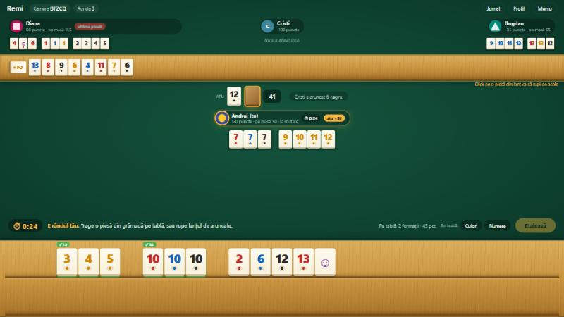

# Remi

A real-time multiplayer version of **Remi pe tablă**, the Romanian tile rummy game, playable in the browser with 2–4 friends. Built with Node.js, Express and Socket.IO.



## Features

- **Real-time multiplayer.** Create a room, share the 5-letter code or link, and play live. Every move is pushed to all players over WebSockets.
- **Server-authoritative rules engine.** A single rules module (`public/rules.js`) is shared by the server, which validates every move, and the browser, which uses it for live previews. Clients can't cheat by sending illegal moves.
- **Full house rules.** Opening threshold (45 points), runs and groups, jokers and joker swaps, breaking the discard chain, the *atu* bonus (an ace atu doubles the round), closing bonus and penalties. All values are configurable in one `RULES` object.
- **Turn timers.** 30 s to draw and 60 s to play. When time runs out, the turn finishes automatically. The timer pauses when nobody is connected and resumes on reconnect.
- **Reconnection.** Players can drop and rejoin. Abandoned rooms are kept for an hour.
- **Accounts.** Passwords hashed with scrypt, token sessions, a login rate limiter, profile pictures, and an all-time leaderboard. The admin account can only be created from the host machine, never through the public tunnel.
- **Tests.** Unit tests with Node's built-in test runner cover the game flow, scoring, rules, timers and the user store.

## Tech stack

Node.js 20+, Express, Socket.IO, vanilla JavaScript/HTML/CSS front end, Docker, Cloudflare Tunnel.

## Project structure

```
server/
  index.js   HTTP + Socket.IO server, rooms, broadcasting
  game.js    game state machine: lobby → draw ⇄ play → round over
  api.js     REST API: login, profiles, admin, leaderboard
  store.js   JSON-file user store (accounts, sessions, avatars)
public/
  rules.js   rules engine shared by server and browser
  client.js  game UI: drag-and-drop rack, table, chain, timers
test/        unit tests (node --test)
```

## Running it

```bash
npm install
npm start          # http://localhost:3000
npm test
```

On first launch, open the site from the host machine to create the admin account. Then add friends' accounts from the admin panel.

**Play with friends over the internet (Windows):** `start-remi.bat` starts the server and a Cloudflare quick tunnel, then copies the public link to the clipboard. Requires `cloudflared` (`winget install Cloudflare.cloudflared`).

**Docker:**

```bash
docker build -t remi .
docker run -p 8080:8080 -v remi-data:/data remi
```

Accounts and avatars are stored in `/data`, so mount a volume to keep them.

## Note

The interface is in Romanian, since it was built for my group of friends.
